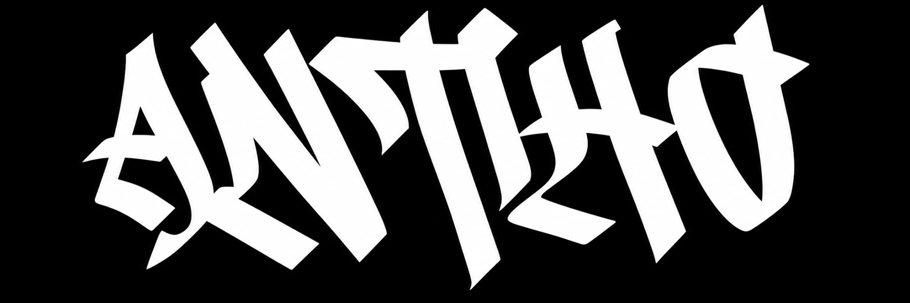
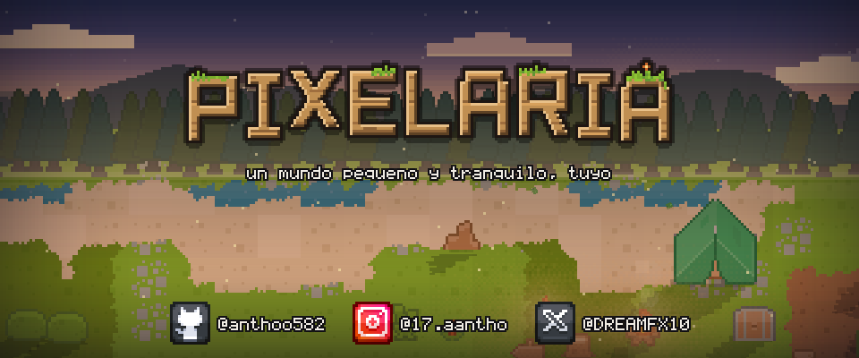

<h3>Hola, soy Anthony 👋</h3>

Programador desde <b>Uruguay</b> 🇺🇾 · Creo videojuegos indie

## 🎮 Mi juego

<b>Pixelaria</b> · <i>Un mundo pequeño y tranquilo, tuyo.</i>

## 🎬 Trailers

<table>
<tr>
<td align="center" width="33%">

 <b>▶ Trailer 1</b>
</td>
<td align="center" width="33%">

 <b>▶ Trailer 2</b>
</td>
<td align="center" width="33%">

 <b>▶ Trailer 3</b>
</td>
</tr>
</table>

## 🛠️ Lo que uso

<table>
<tr>
<th>Lenguajes</th>
<th>Web</th>
<th>Base de datos</th>
</tr>
<tr>
<td align="center"> C++ · C# · PHP</td>
<td align="center"> HTML · CSS · JavaScript</td>
<td align="center"> SQLite</td>
</tr>
</table>

## 💙 Apoyame

Si te gustan mis juegos y querés darme una mano, podés apoyarme por Mercado Pago:

O si preferís, por transferencia:

<table>
<tr>
<th colspan="2">Datos para transferir</th>
</tr>
<tr><td>Número de cuenta</td><td><code>1006138506244</code></td></tr>
<tr><td>Moneda</td><td>UYU</td></tr>
<tr><td>Titular</td><td>Anthony Ezequiel Lopez de Los Santos</td></tr>
<tr><td>Institución</td><td>Mercado Pago</td></tr>
</table>

¡Gracias por pasar! 👾

<!-- Cuenta las visitas al perfil -->

